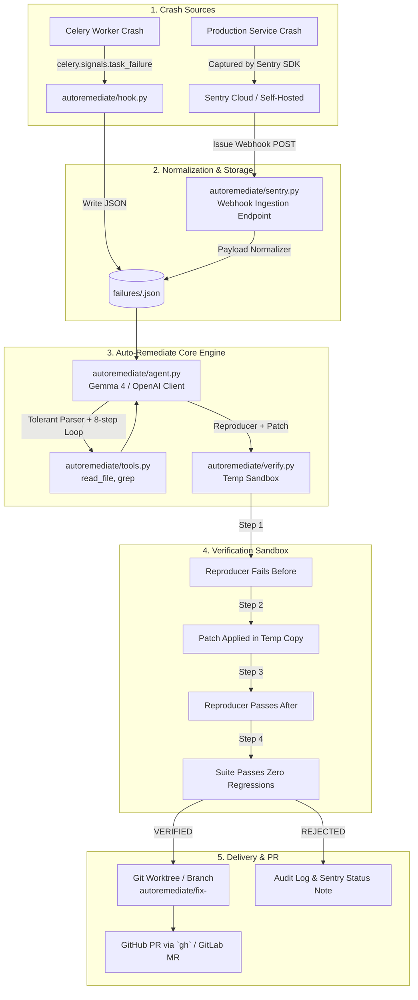

# Auto-Remediate: Architecture, Anti-Hallucination Guardrails & Project Plan

> **Document Purpose**: Single source of truth for the project state, architectural extensions (Sentry integration, Git worktree isolation), anti-hallucination protocols, and phased implementation tasks.

---

## 1. Project Overview & Core Philosophy

**Auto-Remediate** is an autonomous debugging and remediation pipeline for crashed Python Celery tasks (with Sentry APM webhook integration). It leverages an open-weight LLM (e.g., Gemma 4 via Gemini API / OpenAI-compatible endpoint) to diagnose errors, generate isolated reproducer tests, and propose minimal code patches.

### The Golden Rule: Code-Driven Ground Truth (Zero Hallucination Acceptance)
- **The LLM never decides pass or fail.** The model's claims are treated as untrusted hypotheses.
- **Verification is code-driven:** `autoremediate/verify.py` executes real `pytest` commands inside an isolated temporary sandbox.
- Fixes are accepted **only** when:
  1. The reproducer test fails against the unpatched code with the matching exception (`reproducer_fails_before`).
  2. The patch is applied cleanly in the sandbox (`patch_applied`).
  3. The reproducer test passes against the patched code (`reproducer_passes_after`).
  4. The full existing test suite passes with zero regressions (`suite_passes`).

---

## 2. Anti-Hallucination & Context Matching Protocols

To prevent the agent from hallucinating dependencies, non-existent files, speculative fixes, or invalid formats, the following constraints are strictly enforced:

### A. Strict Input/Output Protocol
1. **One-Action Turns**:
   - The LLM must output **either** exactly one JSON line for a tool call:
     ```json
     {"action": "read_file", "args": {"path": "demo_app/tasks.py"}}
     ```
   - **Or** a structured `<final>` tag block (with `<root_cause>`, `<evidence>`, `<confidence>`, `<reproducer_test>`, `<patched_file path="...">`):
     ```xml
     <final>
       <root_cause>...</root_cause>
       <evidence>- ...</evidence>
       <confidence>high|medium|low</confidence>
       <reproducer_test>...</reproducer_test>
       <patched_file path="demo_app/tasks.py">...</patched_file>
     </final>
     ```
   - **Or** a `<give_up>` tag block (when bugs depend on flaky external networks/APIs).
2. **Single Correction Turn**:
   - If model output violates format, `CORRECTION_MESSAGE` is sent once. If the second reply fails to parse, the loop aborts with `AGENT_ERROR` (no infinite hallucination loops).
3. **No Speculative Patches for External Failures**:
   - Flaky external network issues (e.g., `TimeoutError` from third-party APIs) must produce `<give_up>`, demonstrating algorithmic restraint rather than inventing fake mocks or unnecessary retries.

### B. Sandboxed Tool Safety (No Imaginary Files)
- `read_file` and `grep` only resolve within the validated `repo_root`.
- Absolute paths, `..` directory traversal, and symlink escapes return immediate `ERROR: ...` responses.
- Patched file paths must already exist in the target repository and **must never** target files inside the test directory.

### C. Zero In-Place Mutation During Verification
- Model patches and reproducer tests are written **only inside a temporary `shutil.copytree` sandbox**.
- The main repository files are never modified until all 4 verification stages pass and the user explicitly passes `--apply` or `--pr`.

---

## 3. Sentry Integration Architecture

In addition to direct Celery crash capture via signals, Auto-Remediate supports **Sentry Webhook Ingestion** to act as a production self-healing engine.



### A. Sentry Payload Normalizer (`autoremediate/adapters/sentry.py`)
Converts Sentry's rich webhook event JSON into Auto-Remediate's `failures/<id>.json` schema:
- `id`: Sentry Event ID or incremented integer ID.
- `timestamp`: UTC ISO timestamp from Sentry event.
- `task_name`: `event.transaction` or tag `task_name`.
- `args` / `kwargs`: Extracted from Sentry `extra` or Celery context.
- `exception_type` & `exception_message`: Extracted from `event.exception.values[0]`.
- `traceback`: Reconstructed from Sentry stacktrace.
- `frames`: Filtered stack frames (excluding `site-packages` and `.venv`), extracting code snippet and local variables (`vars`).
- `git_sha`: Extracted from `event.release` or local git HEAD.

### B. Ingestion Server (`autoremediate/webhook.py`)
- Lightweight webhook endpoint built with standard Python library (`http.server`) to avoid adding unnecessary heavy dependencies.
- Validates Sentry signature headers (`sentry-hook-resource`, `sentry-hook-signature`).
- Stores normalized failure into `failures/<id>.json` and triggers agent remediation.

### C. Git Worktree & Branch Isolation
- Live developer or server branches remain clean.
- Auto-Remediate creates an isolated worktree/branch:
  ```bash
  git worktree add ../fix-<id> -b autoremediate/fix-<id>
  ```
- Patched files + `test_repro_<id>.py` committed, then pushed with a structured PR generated via `gh pr create`.

---

## 4. Failure Data Contract (`failures/<id>.json`)

The single standard interface connecting hooks, Sentry, agent, and verifier:

```json
{
  "id": "1",
  "timestamp": "2026-10-25T10:15:00Z",
  "task_name": "demo_app.tasks.send_receipt",
  "task_id": "edd40437-afe5-4375-b568-433081032904",
  "args": [
    {
      "id": 42,
      "customer": {"name": "Asha Rao", "email": null},
      "items": [{"price": 10.0, "qty": 2}, {"price": 4.5, "qty": 1}]
    }
  ],
  "kwargs": {},
  "exception_type": "AttributeError",
  "exception_message": "'NoneType' object has no attribute 'lower'",
  "traceback": "Traceback (most recent call last):\n...",
  "frames": [
    {
      "file": "demo_app/tasks.py",
      "line": 11,
      "function": "send_receipt",
      "code": "email = order[\"customer\"][\"email\"].lower()",
      "locals": {
        "order": "{'id': 42, 'customer': {'name': 'Asha Rao', 'email': None}, ...}"
      }
    }
  ],
  "git_sha": "abc1234"
}
```

---

## 5. Implementation Roadmap & Status Tracker

| Task | Title | Description | Status |
|---|---|---|---|
| **T0** | **Environment & Repo Align** | Move kit files to repo root, initialize `.venv`, install `requirements.txt`, configure `.env`. | `Completed` |
| **T1** | **Model Gate Script** | Build `scripts/model_check.py` to verify LLM produces valid `<final>` tags. | `Completed` |
| **T2** | **Capture Hook** | Implement `autoremediate/hook.py` (PII/secret redaction, Celery listener, `failures/<id>.json` output). | `Completed` |
| **T3** | **Sandboxed Tools** | Implement `autoremediate/tools.py` (`read_file`, `grep` with path safety). | `Completed` |
| **T4** | **Verification Engine** | Implement `autoremediate/verify.py` (temp sandbox, 4-stage pytest verification, unified diff). | `Completed` |
| **T5** | **LLM Client** | Implement `autoremediate/llm.py` (OpenAI-compatible client with automatic fallback). | `Completed` |
| **T6** | **Agent Loop** | Implement `autoremediate/agent.py` (`parse_action`, message builder, 8-turn convergence loop). | `Completed` |
| **T7** | **Rich CLI** | Implement `autoremediate/cli.py` (`list`, `fix`, `--replay`, `--apply`, `--pr`, projector-ready Rich panels). | `Completed` |
| **T8** | **Replay & PR Flow** | Offline replay verification without LLM, graceful git/gh degradation. | `Completed` |
| **T9** | **Docs & Packaging** | Complete `README.md`, `pyproject.toml`, DigitalOcean GPU vLLM guide. | `Completed` |
| **T10** | **Stretch / Generalization** | Add tests for Decimal serialization bug and flaky API restraint. | `Completed` |
| **EXT-1** | **Sentry Webhook Adapter** | Add `autoremediate/sentry.py` (normalizer + HMAC verification + webhook listener + fixture test). | `Completed` |

---

## 6. Production Setup & Running Sentry Ingestion

### Step 1: Start the Sentry Webhook Listener
Launch the built-in HTTP webhook daemon:

```bash
autoremediate serve-webhook --host 0.0.0.0 --port 8000
```

### Step 2: Configure Webhook in Sentry
1. In your Sentry project settings, go to **Integrations** or **Developer Settings** > **Internal Integrations**.
2. Create an integration and enable **Webhooks**.
3. Under **Webhook URL**, specify your server URL (e.g., `https://your-domain.com/webhook/sentry`).
4. Copy the **Client Secret** and add it to your `.env`:
   ```env
   SENTRY_WEBHOOK_SECRET=your_sentry_client_secret
   ```
5. Subscribe to **Issue Alerts** / **Error Events**.

### Step 3: Automated Fix & Review
When Sentry fires a webhook event, Auto-Remediate:
1. Validates the `sentry-hook-signature` HMAC-SHA256 header.
2. Normalizes the stack trace and frames into `failures/<id>.json`.
3. Notifies the developer or runs:
   ```bash
   autoremediate fix <id> --pr
   ```
4. Executes the 4-stage sandbox verification before creating a branch and PR.

---

## 7. Context Matching & Grounding Guidelines

1. **Schema Invariance**: All external adapters (Celery, Sentry, Datadog) must strictly map into the `failures/<id>.json` specification.
2. **Code-Driven Truth**: The LLM's suggested code is never trusted directly; `verify.py` acts as the impartial arbiter.
3. **Pristine Reference**: The reference starter kit (`auto-remediate-kit/`) remains untouched for baseline parity.
